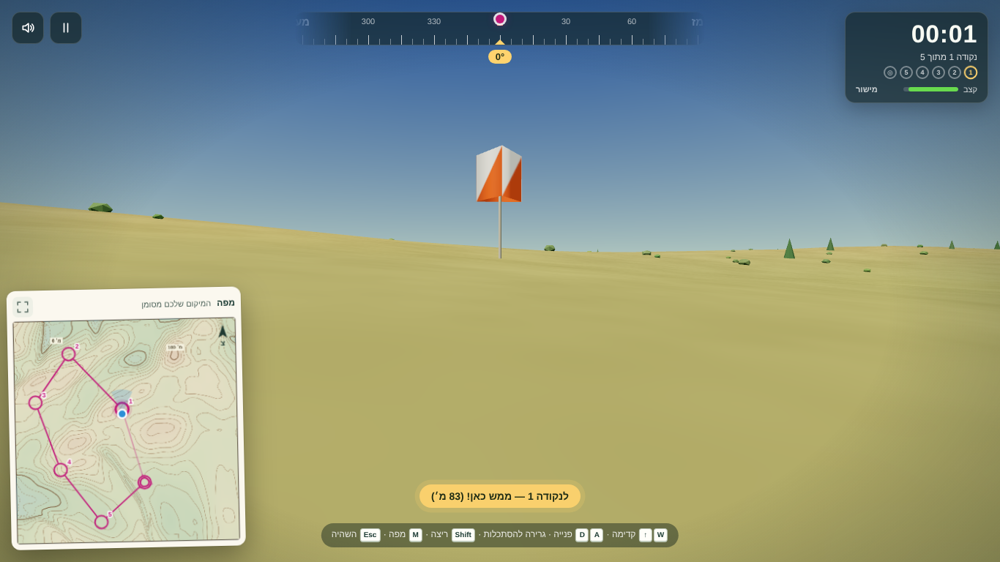

# ניווט: תכנון מסלול ומשחק ניווט

תלמידים מתכננים מסלול על המפה (זינוק, נקודות ביקורת וסיום), ואז מנווטים אותו בגוף ראשון בתוך התבליט שפיסלו.
הרעיון הוא ניווט אמיתי: קוראים מפה טופוגרפית, מתמצאים בעזרת מצפן ומשלמים בזמן על בחירת דרך גרועה.

## זרימת שימוש

1. **תכנון** (כלי "מסלול" בסרגל הכלים, `C`):
   - לחיצה ראשונה מציבה את **הזינוק** (משולש). כל לחיצה נוספת מוסיפה **נקודת ביקורת** ממוספרת (עיגול).
   - בבורר שבסרגל האפשרויות אפשר לבחור **סיום** נפרד (עיגול כפול). בלי סיום, המסלול חוזר לזינוק.
   - גרירה של נקודה קיימת מזיזה אותה. "הסרת אחרונה" (או Backspace) ו"ניקוי" ניתנים לביטול.
   - **מסלול אקראי**: בוחרים 3–10 נקודות. ראו "מחולל המסלולים" למטה.
   - המסלול נשמר אוטומטית עם העבודה, ונשאר במקום כשמשנים את גודל השטח.
2. **תדריך** (כפתור "ניווט" בסרגל העליון, "יציאה לניווט" או `G`): מפת המסלול, נתוני המסלול, בחירת רמת קושי והשיא האישי.
3. **ניווט**: התלת־ממד ממלא את המסך. ספירה לאחור, ואז יוצאים לדרך.
4. **תוצאות**: זמן, עונשים, שיא, יעילות לכל מקטע, ומפת הדרך שהלכתם על גבי המסלול.

## רמות קושי

| רמה | מפה בשטח | מיקום על המפה | חץ במצפן לנקודה | מרחק לנקודה |
|---|---|---|---|---|
| קל | פתוחה | ✓ | ✓ | ✓ |
| רגיל | פתוחה | — | — | — |
| מאתגר | נפתחת לפי בקשה (`M`), **+15 שניות** לכל הצצה | — | — | — |
| מהזיכרון | אין. לומדים את המפה בתדריך בלבד | — | — | — |

ב"התאמה אישית" אפשר לשלב את האפשרויות בכל צורה. השיא נשמר לכל מסלול ולכל רמה בנפרד (`localStorage`, מפתח `topolab-nav-best`).

## מקשים בזמן ניווט

| מקש | פעולה |
|---|---|
| `W` / `↑` | קדימה. `S` / `↓` אחורה (לאט יותר) |
| `A` / `D`, `←` / `→` | פנייה |
| גרירה על המסך | הסתכלות לצדדים ולמעלה/למטה |
| `Shift` | ריצה (×1.8) |
| `M` | מפה: הגדלה, או הצצה ברמה "מאתגר" |
| `L` | פנס ראש (בדמדומים ובלילה, או הכפתור 🔦) |
| `Esc` | השהיה (הזמן עוצר והמפה מוסתרת) |

במכשירי מגע יש שני ג'ויסטיקים:
- **שמאלי, "תנועה"**: למעלה ולמטה זה קדימה ואחורה, לצדדים זה צעדים הצידה. דחיפה עד הקצה = ריצה.
- **ימני, "מבט"**: ימינה ושמאלה זה פנייה, למעלה ולמטה זה הטיית המבט.

**בטלפון** (רוחב עד 640px, או מגע בגובה עד 500px) ה-HUD מצטמצם: הטיימר והנקודות בשורה אחת, והמצפן מתחת. המפה מוצגת כ**תמונה ממוזערת** בפינה, ונגיעה בה פותחת אותה בגדול. במצב לאורך היא מוצגת מתחת למצפן, ובמצב לרוחב במרכז בין הג'ויסטיקים. נגיעה נוספת מקטינה אותה. ברמה "מאתגר" הצצה נפתחת ישר בגודל מלא, וכפתור "סגירת המפה" עובר אל מתחת למפה. העיצוב ב-`style.css` (מקטע "Phones"), וההחלפה ב-`compactLayout` שב-`nav-game.js`.
קיצורי המקלדת הרגילים של האפליקציה מושבתים בזמן המשחק (`shortcuts.js` בודק את `body.navigating`).

## חוקי המשחק

- **הגעה לנקודה**: בתוך רדיוס של `max(15 מ׳, 1.2% מצלע המפה)` (48 מ׳ במפה של 4 ק"מ). הנקודות נספרות רק לפי הסדר.
- **נקודה לא נכונה**: אם מגיעים לנקודה אחרת, מופיעה ההודעה "זוהי נקודה 3 — אתם מחפשים את 2".
- **קצב** (בחירה בתדריך, `topolab-nav-pace`):
  - **אמיתי:** 1.4 מ׳/ש׳ (5 קמ״ש).
  - **×3:** 4.2 מ׳/ש׳.
  - **×6:** 8.4 מ׳/ש׳ (ברירת המחדל).
  - **מהיר:** `צלע המפה / 150` מטר לשנייה, כמו בעבר (כ־27 מ׳/ש׳ ב־4 ק״מ).
  - **ריצה** (Shift) מהירה פי 2.4 מההליכה (20 מ׳/ש׳ בקצב ×6).
  - **מה משתנה:** הגמלים נמדדים ביחס לקצב שנבחר, ושעון השמיים בדמדומים ובלילה רץ לפחות פי 12. הרחפן נשאר מהיר.
  - **קצב הצעדים טבעי:** עד 2 צעדים בשנייה בהליכה ו־3 בריצה. במהירויות גבוהות הצעד ארוך יותר, כך שהידיים והצעדים לא "מתזזים".
  - **המשך הנוסח הקודם על המהירות:** המהירות מוגזמת בכוונה, כדי שמסלול יימשך דקות ולא שעות. השיפוע בכיוון ההליכה משפיע עליה (`slopeSpeedFactor`): עלייה של 20% מאטה לחצי מהמהירות, ירידה מתונה מאיצה מעט, וירידה תלולה מאטה שוב. סרגל ה"קצב" ב-HUD מראה את ההשפעה. זה מלמד בחירת דרך: לפעמים עדיף להקיף גבעה.
- **הגזמה אנכית בשטח:** בוחרים בתדריך ×1 (אמיתי), ×3, ×5 או ×10. ברירת המחדל היא ×10, והבחירה נשמרת (`topolab-nav-relief`).
  - **למה צריך הגזמה:** בלעדיה גבעה של 90 מ׳ במפה של 4 ק״מ כמעט לא נראית מגובה העיניים, ואז השטח לא נראה תואם למפה.
  - **ההגזמה משפיעה על התצוגה בלבד.** המהירות, הטיפוס וזמן נייסמית׳ מחושבים לפי השיפוע האמיתי.
  - **ביציאה מהמשחק** חוזר הערך הקודם.
  - **מיקום עצמים:** שיחים, דגלים, רוג׳ומים ועצים מונחים על משולשי פני השטח (`groundAt`), כדי שלא ירחפו בהגזמה גבוהה.
- **התוצאות**: זמן כולל = זמן ריצה + עונשי הצצה + עונשי גמלים. יעילות = קו ישר ÷ המרחק שהלכתם (עד 100%). "בשטח אמיתי" מחושב לפי **כלל נייסמית'**: ‏5 קמ"ש ועוד שעה לכל 600 מ' טיפוס.

## גמלים

בתדריך בוחרים 🐪 **בלי / מעט (8) / הרבה (16)**. ברירת המחדל היא "מעט", והבחירה נשמרת (`topolab-nav-camels`).

**איפה הם:**
- **בעיקר בעמקים:** לכל תא מחושב **ציון עמק**, שהוא הגובה הממוצע בחלון של כ־250 מ׳ פחות הגובה בתא (topographic position index). הציון חיובי בגיאיות ובשקעים ושלילי ברכסים.
- **בעדרים, ליד המסלול:** עדרים של 1–3 גמלים מוגרלים לפי הציון, ובעיקר בעמקים שליד המסלול.
  - **הסיכוי:** משקל התא מוכפל ב־`0.08 + e^-(d/240)²` (d = המרחק מהקו בין הנקודות, 6% מהצלע).
  - **למה:** כשהגמלים פוזרו על כל המפה, רק כשליש מהמסלולים עברו בטווח שבו גמל מבחין בכם.
  - **התוצאה:** עכשיו ב־"מעט" כ־95% מהמסלולים עוברים בטווח של 140 מ׳ מגמל.
- **הרחק מהזינוק** (לפחות 10% מצלע המפה ולפחות 250 מ׳), **ולא ממש על נקודה** (לפחות 2.5% מהצלע, 100 מ׳ במפה של 4 ק״מ).
- **רעייה:** גמל עומד ורועה (ראש למטה), ומדי פעם עובר כמה עשרות מטרים למקום הנמוך ביותר מבין כמה מועמדים. כך העדרים נשארים בעמקים.

**מתי הם רודפים** (`stepCamel`, מכונת מצבים):
1. **רעייה:** כשהולך רגלי נכנס לרדיוס הזיהוי (`max(60 מ׳, 4% מהצלע)`, 160 מ׳ במפה של 4 ק״מ), כל גמל מחליט אם לרדוף לפי "תוקפנות" אקראית משלו.
2. **"שם לב":** מרים את הראש ובוהה בכם כשנייה.
3. **מרדף:** רץ אליכם במהירות של ×1.08 ממהירות ההליכה. **בהליכה לא בורחים ממנו. בריצה (Shift, ×1.8) כן.** הוא גם מאט פחות בעלייה (גרר שיפוע 2 לעומת 5 אצל הולך), ולכן בעלייה הוא משיג אתכם. אחורה זה איטי מדי: צריך להסתובב ולרוץ.
4. **השיג:** "יורק" (כתמים על המסך), מוסיף **20 שניות**, ואתם קפואים לשנייה. אחר כך הוא נח 30 שניות.
5. **ויתר:** אחרי 10–18 שניות, או כשהתרחקתם יותר מפי 2.4 מרדיוס הזיהוי, נחשב שברחתם. הוא נח 12–20 שניות.

**חריגים:**
- רחפן לא מעניין גמלים, וגמל שרודף מוותר כשממריאים.
- **בחושך** הם מבחינים בכם רק מחצי מהמרחק (יותר באור ירח). **פנס דלוק** מגדיל את המרחק פי 1.5.

**בממשק:**
- **כשמתקרבים לעדר הראשון** מופיעה פעם אחת הודעה כמו "🐪 גמלים בצפון־מזרח, 300 מ׳ מכם".
- **בזמן מרדף:** תווית "🐪 גמל רודף אחריכם · 48 מ׳", שמאדימה ומהבהבת מקרוב, ו־🐪 על המצפן בכיוון שלו.
- **צלילים:** נהמה כשגמל שם לב ורודף, ויריקה כשהוא משיג אתכם.
- **בתוצאות:** "נתפסתם X · ברחתם Y".

**המראה** (`buildCamels`):
- **דגם:** גמל חד־דבשתי בצורה פשוטה. במפות גדולות הוא מוגדל כמו הרוג׳ומים, כדי שעדר ייראה מכמה מאות מטרים: `צלע/1600` בין פי 1 לפי 3, כלומר פי 2.5 במפה של 4 ק״מ.
- **צבע:** פרווה מחום־חול ועד חום כהה, כהה מהעשב כדי שעדר יבלוט.
- **הליכה:** הרגליים זזות לפי הצעדים בהליכת "פסיעה" (pace), שבה שתי הרגליים באותו צד נעות יחד, כמו אצל גמל אמיתי.
- **ראש:** למטה ברעייה, למעלה כשהוא שם לב, וקדימה במרדף.
- **צל** רך מתחת לגמל, מוטה לפי השיפוע.
- **בלילה,** באור הפנס, העיניים מחזירות אור.

## ניווט בדמדומים ובלילה

בתדריך, תחת "שעה": ☀️ **יום** (כמו תמיד), 🌆 **מחשיך** (יוצאים ב־17:40, השמש שוקעת ב־18:00 ומחשיך תוך כדי), או 🌙 **לילה** (שעת יציאה מ־19:00 עד 04:00). הבחירות נשמרות.

**הירח לפי יום בחודש העברי:**
- **השלב:** החודש העברי ירחי. בא׳ הירח חדש ואין ירח בלילה, בח׳ יש רבע ראשון, בט״ו ירח מלא כל הלילה, ובכ״ב רבע אחרון שזורח אחרי חצות. הגיל נחשב מהמולד, והיום העברי מתחיל בערב.
- **בתדריך:** מחוון של יום בחודש, ציור של הירח בשלב שלו, ושורת הסבר, למשל "ביציאה הירח בדרום־מזרח, 39° מעל האופק, ושוקע ב־06:08", או "יזרח ב־00:42".
- **המיקום בשמיים** מחושב באמת (`sky.js`):
  - **ההנחות:** קו רוחב 31.5° (מרכז הארץ) סביב השוויון של מרץ, כלומר זריחה ב־6:00 ושקיעה ב־18:00.
  - **הירח** על המילקה, בזווית מהשמש לפי גיל הירח. לכן הסהר של ערבי האביב גבוה, והחרמש פונה לשמש.
  - **המיקום** מחושב משעה כוכבית.

**השמיים בתלת־ממד:**
- **צבעים:** צבעי הדמדומים מחושבים לפי גובה השמש, כולל הזוהר הכתום־סגול מעל המערב.
- **הירח** הוא כדור שהשמש מאירה בתוך ה-shader, כך שהשלב והטיית החרמש נכונים. סביבו הילה לפי בהירותו.
- **כוכבים:**
  - כ־1,400 כוכבים אקראיים, ועוד כוכבים בהירים במקומם האמיתי: כוכב הצפון, העגלה הגדולה, קסיופאה, אוריון, סיריוס ועוד.
  - הם מסתובבים עם השמיים, ולכן **כוכב הצפון מסמן צפון** בגובה 31.5°.
  - אור הירח מחוויר אותם.

**אור ותאורה:**
- **האור הראשי** הוא השמש, ובחושך עובר לירח: אור כחלחל שתלוי בשלב ובגובה הירח. בירח מלא רואים את השטח, ויש צללים.
- **אור השמיים** נחלש, והחשיפה עולה בהדרגה, כמו עין שמתרגלת לחושך.
- **ערפל כהה וקרוב יותר.** רכסים רחוקים נשארים קווי מתאר כהים מול השמיים: כך מנווטים בלילה.
- **פנס ראש** (`L` או 🔦):
  - אלומה חזקה קדימה (כ־100 מ׳ במפה של 4 ק״מ) ואור רך סביב הרגליים.
  - **הפתקים והדגלים מחזירים אור** כשהפנס מכוון אליהם. בלי פנס הם כמעט לא נראים.
  - אבל **הפנס מושך גמלים** (ראו למעלה).
- **המפה** בכרטיס נצבעת בגוון אדמדם, כמו מפה שקוראים בפנס אדום.

**השעון:**
- **מהירות:** שעון השמיים רץ כמו מהירות ההליכה במשחק (פי 12–30, פי ~19 במפה של 4 ק״מ). כך הלילה מתקדם כמו המרחק שעברתם: בניווט של כמה דקות מחשיך באמת.
- **ב-HUD:** השעה ליד הטיימר, עם סמל שלב הירח.
- **בתוצאות:** שעת היציאה ושעת הסיום.

**שיאים:** ניווט בדמדומים ובלילה נשמר בשיא נפרד מניווט ביום.

**מימוש:**
- **`src/sky.js` (טהור, עם בדיקות):** `moonPhase`, `moonDirection`, `sunDirection`, `moonTimes`, `skyState` (כל הצבעים והעוצמות), `skyBasis` (סיבוב הכוכבים) ו-`BRIGHT_STARS`.
- **`nav-game.js`:** `applySky` מעדכן את ה-shader של השמיים והכוכבים, ו-`advanceClock` מקדם את השעון.
- **`scene.js`:** `setLighting(sky)` מזיז את האור הראשי, את אור השמיים, את החשיפה ואת הערפל, ו־`null` מחזיר אור יום.
- **צבעי השמיים בערכי תצוגה:** ה-shader כותב אותם ישירות למסך, ושורת היום זהה בדיוק לשמיים הרגילים של המשחק.

## מצב רחפן (צ׳יט)

תוך כדי ניווט אפשר "להפוך לרחפן" ולטוס מעל השטח, במבט של מצלמת רחפן.

**הפעלה וכיבוי:**
- **במקלדת:** מקלידים **"רחפן"** (במקלדת עברית) או **"drone"** (באנגלית). הקלדה חוזרת נוחתת.
- **במסך מגע:** חמש נגיעות מהירות על השעון.
- **נחיתה:** כפתור "🛬 נחיתה".

**שליטה:**
| מקש | פעולה |
|---|---|
| `W` / `S` | קדימה ואחורה |
| `A` / `D` | סיבוב |
| `E` / `Q` | עלייה וירידה (גם PageUp/PageDown) |
| גלגלת | שינוי גובה בקפיצות |
| גרירה | זווית מצלמה (גימבל) |
| `Shift` | טורבו |
| `F` | מעבר ל־FPV (ראו בהמשך) |
| ג׳ויסטיקים | שמאלי לטיסה, ימני למבט |
| ▲ ▼ | עלייה וירידה במסך מגע |

**חוקי הטיסה** (`src/drone.js`, עם בדיקות):
- **החזקת גובה:** הרחפן שומר על הגובה שנבחר. כשהקרקע עולה מתחתיו הוא מטפס לבד, ולא יורד מתחת ל־8 מ׳ מעל הקרקע. התקרה היא 500 מ׳ מעל הקרקע.
- **קריאת פתק:** אפשר לקרוא פתק רק בריחוף נמוך, מתחת ל־40 מ׳ ובתוך רדיוס הנקודה. גבוה יותר מופיע הרמז "הנמיכו…".
- **סוללה:** מספיקה ל־4 דקות טיסה, ומתחת ל־15% יש אזהרה. כשהיא נגמרת הרחפן נוחת לבד. בהליכה היא נטענת (0.5% לשנייה).
- **הנחיתה** היא במקום שבו הרחפן נמצא, וממשיכים משם ברגל.
- **השיא לא נשמר:** סיבוב שהשתמש ברחפן לא קובע שיא אישי, והתוצאות מסומנות "🚁 בעזרת רחפן". מוצג המרחק שנטס, ובמפת הדרך הקטעים בטיסה מקווקווים בסגול.

**התצוגה:**
- **מסגרת מצלמה:** פינות מסגרת, כוונת, ו־REC עם שעון טיסה.
- **נתונים:** גובה מעל הקרקע, גובה הקרקע לפי המפה (נוח להשוואה לקווי הגובה), מהירות וסוללה.
- **מד גובה** בצד.
- **"צל" על הקרקע** מתחת לרחפן, מוטה לפי השיפוע, כדי לעזור להעריך גובה.
- **עדשה רחבה (74°)** וערפל רחוק יותר.
- **זמזום מדחפים** שקט (אם הצלילים פועלים).
- **הרחפן "רואה" GPS:** המיקום מוצג על המפה בכל רמה, כשהמפה גלויה.

**מימוש:** `nav-game.js` (`toggleDrone`, `flyStep`, `land`). המצלמה ב-`scene.js` טסה לפי `observer.flyY`. הגבהים במטרי תצוגה, כלומר גובה × ההגזמה האנכית. בדיקות בדפדפן: `window.__NAV_DRONE__()`.

### מצב FPV (רחפן מרוץ)

מצב שני של הרחפן: מהיר, עם תנע, וטס לאן שהאף מכוון.

**הפעלה:**
- **מהקרקע:** מקלידים **"fpv"**, או **"כפה"** (אותם מקשים במקלדת עברית). הרחפן מזנק למעלה ישר במצב FPV.
- **באוויר:** `F` (או הכפתור "⚡ FPV") עובר בין FPV לרחפן הצילום.
- **במסך מגע:** חמש נגיעות בשעון, ואז "⚡ FPV".
- **נחיתה:** הרחפן עובר קודם לרחפן הצילום ואז נוחת.

**שליטה:**

| מקש | פעולה |
|---|---|
| `W` / `S` | גז ובלם |
| `↑` / `↓` | אף למטה ולמעלה (↑ = צלילה, כמו דחיפת סטיק) |
| `A` / `D` | פנייה (הרחפן נוטה לתוך הפנייה) |
| `Space`/`E` ו־`Q` | דחף מעלה ומטה |
| `Shift` | בוסט |
| `R` | סיבוב חבית (טריק) |
| `F` | חזרה לרחפן הצילום |
| ג׳ויסטיקים (Mode 2) | שמאלי: גז ופנייה, ודחיפה עד הסוף היא בוסט. ימני: אף, וצד |

**פיזיקה** (`src/drone.js`: `fpvVelocity`, `fpvGround`, `terrainAhead`, עם בדיקות):
- **"טסים לאן שמסתכלים":** הדחף בכיוון המבט, כולל הטיה. כשהאף למטה, צוללים.
- **תנע:** האטה מעריכית (גרר). בגז מלא המהירות מתייצבת על המהירות המרבית תוך כ־2 שניות. בלי גז, הרחפן גולש ונעצר.
- **מהירות לפי גודל המפה:** 35 מ׳/ש׳ לכל ק״מ, בין 60 ל־260 מ׳/ש׳. במפה של 4 ק״מ זה 140 מ׳/ש׳ (כ־500 קמ״ש), ובבוסט ×1.8 (כ־900 קמ״ש).
- **קרקע:**
  - מותר "לגלח" את הקרקע עד 3 מ׳ מעליה.
  - פגיעה מהירה מ־35 מ׳/ש׳ (צלילה, או טיסה לתוך מדרון) היא **התרסקות**: קפיצה למעלה, איבוד רוב המהירות, רעד, הבזק אדום ו־4% סוללה.
  - בין התרסקויות יש הפסקה של 0.8 ש׳, כדי שמגע ממושך לא ייספר שוב ושוב.
- **סוללה:** נגמרת פי 2 מהר יותר מברחפן הצילום.
- **פתקים:** אותו חוק כמו ברחפן הצילום (מתחת ל־40 מ׳ ובתוך רדיוס הנקודה), כך שאפשר לחטוף פתק בצלילה נמוכה.

**תצוגה (OSD של משקפי FPV):**
- **אופק מלאכותי** שזז עם ההטיה ומסתובב עם הגלגול. הוא מחושב בהיטל פרספקטיבי, ולכן מתלכד עם האופק האמיתי. יש גם קווי ±10°.
- **מהירות** גדולה בקמ״ש, **פס גז**, ותג ACRO / BOOST / FLIP.
- **PULL UP:** מופיע כשמסלול הטיסה הנוכחי פוגש את הקרקע בתוך 1.2 ש׳, בצלילה או מול מדרון. טיסה נמוכה ומאוזנת לא מפעילה אותו.
- **עדשה רחבה** של 92° שנפתחת עם המהירות עד 125° בבוסט, **פסי מהירות**, **רעד** במהירות גבוהה ובמגע בקרקע, ו**גלגול מצלמה** בפניות ובטריק.
- זמזום המנוע חזק וגבוה יותר, ועולה עם המהירות.
- **בתוצאות:** מהירות שיא, מספר טריקים ומספר התרסקויות.

**מימוש:** `nav-game.js` (`setFpv`, `fpvStep`, `crash`, `startTrick`, `updateFpvOsd`, `drawSpeedLines`). ב-`scene.js` המצלמה מקבלת מ־`observer` את `roll` (גלגול), `fov` (עדשה) ו־`shake` (רעד).

## ריאליזם בשטח

הכול נבנה בקוד, בלי קבצים מבחוץ: אין גישה להורדת טקסטורות או מודלים, וכך גם אין תלות ברישוי.

**הקרקע** (shader ב-`scene.js`, רק במשחק):
- עשב יבש ים־תיכוני, כתמי אדמה אדומה (טרה רוסה), וסלע גיר אפור עם שכבות אופקיות.
- הסלע מופיע לפי **השיפוע האמיתי** (בלי ההגזמה האנכית), ועוד מחשופים לפי רעש.
- תבליט עדין דרך הנורמלים (bump).
- כשבע דגימות רעש לכל פיקסל, והפרטים הקטנים דוהים במרחק.

**צמחייה וסלעים** (`field-models.js`):
- **עצים:** אורן ירושלים ואלון מצוי, מגושים "גבשושיים" עם צבע משתנה.
- **שיחים:** כריות אפורות־ירוקות.
- **סלעי גיר:** יותר מהם במדרון תלול.
- **חלוקה לגושים:** העצים והסלעים מחולקים ל־6×6 גושים, כך שמה שמחוץ למבט ולאזור הצל לא מצויר. גוש רחוק מ־550 מ׳ עובר לדגם פשוט (`updateChunkDetail`).
- **עשב ושיחים רק סביב ההולך:** הם יושבים על "אריח" עולמי (60 מ׳ לעשב, 320 מ׳ לשיחים) שנפרש מחדש סביבכם (`updateScatter`). כל פריט מחושב מחדש רק כשהוא עובר לתא חדש.

**צללים:** במשחק מפת הצל של השמש מכסה רק כ־1.4 ק״מ סביב ההולך ועוקבת אחריו, ולכן לעצים, לסלעים ולגמלים יש צללים חדים (`setGameShadow` ב-`scene.js`).

**הגמל** (`createCamel`, `poseCamel`):
- **צורה:** גוף עם דבשת מעוגלת וחזה עמוק, צוואר בצורת S שמתחדד, וראש עם חוטם.
- **רגליים:** ירך וברך, ורגל שנקפלת כשהיא נעה קדימה.

**הידיים** (`createHands`):
- **מבט:** בגוף ראשון רואים את הידיים, והן מצוירות במעבר נפרד מעל השטח (`setOverlay`).
- **יד ימין:** מצפן בסיס שהמחט שלו תמיד מצביעה צפונה.
- **יד שמאל:** בדמדומים ובלילה מחזיקה פנס, ועדשתו נדלקת עם `L`.
- **תנועה:** הידיים מתנדנדות עם הצעדים, ובריצה מהר וחזק יותר. ההליכה מקפצת יותר בריצה.

**רוח** (`wind.js`, טהור, עם בדיקות):
- **כיוון וחוזק:** בעיקר מערבית (בריזה), בעוצמה שנבחרת לכל ניווט, ומשבים.
- **רואים אותה:**
  - העשב, השיחים והעצים נוטים ומתנדנדים, וגלי משב עוברים על פני השטח (`addWindSway`).
  - במשבים חזקים עפים ענני אבק.
- **מרגישים אותה:** הליכה מול הרוח איטית עד 12%, ועם הרוח מהירה עד 5%.
- **שומעים אותה:** הרוח נשמעת מהצד שממנו היא באה.
- **ב-HUD:** למשל "💨 רוח מערבית חזקה".

**מאמץ** (`effort.js`, טהור, עם בדיקות):
- **עייפות:** מצטברת בריצה ובעלייה, ויורדת בהליכה ובמנוחה.
- **ריצה:** כשהעייפות גבוהה הריצה מאטה, עד 82% מהמהירות.

**צלילים** (`field-audio.js`, מסונתזים):
- **צעדים לפי הקרקע:** עשב, סלע, דרך או יער.
- **נשימות:** מהירות וחזקות יותר עם העייפות.
- **אנחת מאמץ** בעלייה קשה.
- **רוח** שעולה במשבים.
- **אבק** נראה מתחת לרגליים בריצה ומאחורי גמל שרודף.

**איכות גרפיקה:** בתדריך בוחרים מלאה או קלה (`topolab-nav-quality`). קלה מצמצמת עשב, שיחים, עצים וסלעים, וברירת המחדל במכשירי מגע היא קלה.

## מנוע v2: גרפיקה ריאליסטית (ענף `engine/visual-v2`)

`src/field-engine.js`, פעיל רק במשחק. העורך והתצוגה הרגילה לא משתנים.

**חומרים מצולמים:** טקסטורות PBR חופשיות (CC0, ‏Poly Haven) ב-`public/assets/field/`, ראו README שם.
- **שלוש שכבות:** עשב יבש עם סלעים (`aerial_grass_rock`), אדמה אדומה (`red_laterite_soil_stones`) וסלע גיר (`rock_boulder_dry`).
- **החלוקה בין השכבות** היא אותה חלוקה של הקרקע הפרוצדורלית: לפי השיפוע האמיתי ולפי רעש.
- **נגד חזרתיות:** עשב ואדמה נדגמים בשני קני מידה.
- **סלע בהטלה משלושה כיוונים** (triplanar), כדי שלא יימתח על מדרונות שההגזמה האנכית מתלילה.
- **מפות נורמלים** לכל שכבה.
- **עד שהקבצים נטענים** מוצגת הקרקע הפרוצדורלית (`uTexReady`).

**שמיים אמיתיים ביום:**
- **הרקע:** צילום פנורמי של שמיים עם עננים (`sky_4k.jpg`), במקום כיפת השמיים המצוירת.
- **תאורה מהתמונה (IBL):** מ-`sky_1k.hdr`, דרך PMREM.
- **השמש** במשחק ממוקמת בדיוק היכן שהיא בצילום: הפיקסל הבהיר ביותר ב-HDR (`findSun`). כך הצללים מתאימים לשמיים.
- **בדמדומים ובלילה** נשארים השמיים של `sky.js`.

**עיבוד תמונה** (ביום, בגרפיקה "מלאה"):
- **הצללה רכה בשקעים** (GTAO), ברדיוס של 2.5 מ׳ אמיתיים.
- **הילה עדינה** (bloom).
- **מיפוי טונים ו-sRGB** (OutputPass).
- **כיול צבע:** קצת ניגודיות, חמימות וּוינייטה.
- **החלקת קצוות:** מטרת ציור עם MSAA ×4.
- **מה לא מקבל עיבוד:** הידיים והבלופר מצוירים אחרי העיבוד ובלעדיו.

**גרפיקה "קלה":** החומרים והשמיים בלי עיבוד התמונה.

**חומרים מצולמים גם לסלעים ולצמחים** (`addSurface` ב-`field-models.js`):
- **סלעים וגבעת המערה:** טקסטורת גיר ומפת נורמלים בהטלה משלושה כיוונים, בקני מידה של מטרים.
- **צמרות ושיחים:** פרטי עלים (`forest_leaves_03`) על הגוונים הירוקים.
- **גזעים:** קליפת אלון (`jolcham_oak_bark_01`). מה גזע ומה צמרת נקבע לפי צבע הקודקוד: חום או ירוק.
- **שילוב עם הרוח:** אותה הרחבת shader כמו הנדנוד ברוח (`installShader`), כך ששני האפקטים עובדים יחד.

**עיבוד תמונה גם בדמדומים ובלילה:**
- **הבעיה:** שמי הלילה (`sky.js`) כותבים צבעי תצוגה ישירות, ומיפוי הטונים של שרשרת העיבוד היה משנה אותם.
- **הפתרון:** הכיפה והכוכבים מפעילים **הפיכה מדויקת** של ACES ו-sRGB (`postLinear`, ‏`postUniforms`), כך שהשמיים נראים אותו דבר. בדיקה מספרית מראה שגיאה של 0.
- **בלילה** רק ההילה פעילה, חזקה יותר ומסף נמוך יותר, כדי שהירח והפנס יזרחו. הצללה בשקעים כבויה, כי היא רק משחירה את החושך, והכיול עדין יותר.
- **בהירות:** הטקסטורות המצולמות כהות מהצבעים הפרוצדורליים שהתאורה כוילה להם. לכן מחוץ לשמיים המצולמים יש להן הגברה (`uTexGain`: ‏1.9 בלילה, 1.12 ביום).

**עצים רחוקים כתמונה (impostors):**
- **איך:** אחרי טעינת העלים, כל סוג עץ "מצולם" פעם אחת מהצד לטקסטורה (`bakeImpostor` ב-`scene.js`).
- **במרחק:** גושי עצים רחוקים מ־900 מ׳ מצוירים כריבוע שפונה תמיד למצלמה (billboard), עם חיתוך שקיפות ותאורה "של צמרת".
- **רמות פירוט:** מ־550 מ׳ מצויר דגם פשוט, ומקרוב הדגם המלא.
- **התוצאה:** אפשר לשים בערך פי 2.3 עצים (160 לקמ״ר, עד 2,800).

**שמי שקיעה אמיתיים בדמדומים:**
- **הצילום:** צילום שקיעה (`sunset_4k.jpg`, ‏belfast_sunset_puresky) מוצג מאחורי השמיים של המשחק כל עוד השמש מעל האופק.
- **יישור:** הצילום מסובב כך שהשמש שבו (נמדדה מראש ב־u=0.636) נמצאת בדיוק בכיוון השמש של `sky.js`.
- **מעבר לחושך:** ככל שהשמש שוקעת (מ־2° מעל האופק ועד 3° מתחתיו) כיפת השמיים המצוירת, שעכשיו שקופה למחצה (`uBackdrop`), מתמלאת ומחליפה אותו. משם ממשיכים דמדומים ולילה כרגיל.

**מסך טעינה:**
- `start()` אסינכרוני, ולפני כל שלב כבד מתעדכן מסך עם פס התקדמות ומשפטים בסגנון "מכין כרטיס פרויקט…", "מתבכיין לרכז…", "חורג מהתקציב…", "מוכן!".
- **טעינת הקבצים** מדווחת על התקדמות אמיתית.
- **ה-shaders מקומפלים מראש** (`compileField`: ‏`renderer.compileAsync` ופריים אחד), כך שאין קפיאה בפריים הראשון.
- **בזמן הטעינה לא מצויר כלום ברקע** (`pauseRender`).
- **אנימציית הברק** על הפס היא transform, ולכן היא ממשיכה לזוז גם כשהדף עסוק.
- **בהמתנה ארוכה** מתחלפים משפטי מילוי ("מתווכח על הנ״צ…").

**מגבלות:**
- בדפדפן המדומה, שרץ בלי כרטיס גרפי, העלייה לוקחת עשרות שניות. בכרטיס גרפי אמיתי זה כשבריר שנייה, אבל צריך לבדוק במכשירים אמיתיים.
- הקבצים שוקלים כ־3.2 MB, ומתחילים להיטען כבר כשהתדריך נפתח (`preloadEngine`).

## בלופר: המערה לנתיבות 🕳️

בכל ניווט מוסתרת מערה אחת במקום אקראי, **תמיד בגיא**.
- **איפה:** `pickCaveSpot` ב-`cave.js` (טהור, עם בדיקה) בוחר תא מ־12% העליונים של ציון העמק, ולפחות 300 מ׳ מכל נקודה במסלול. הפתח פונה במורד הגיא.
- **מראה:** גבעת סלע עם פתח קשתי שחור, שפה סלעית וסלעים מסביב (`createCaveMound` ב-`netivot.js`). היא לא מסומנת במפה.
- **בכניסה:**
  - כשמתקרבים הפנס זמין גם ביום (`L` או 🔦), ומופיעה הודעה.
  - **בלי פנס אי אפשר להיכנס:** ההולך נהדף החוצה מהפתח.
- **הרצף** (`stepBlooper`). השעון עוצר, והמפה, המצפן והגמלים מוסתרים.
  1. **מערה:** מנהרת סלע מתפתלת שרק הפנס מאיר (`createCaveInterior`). מתקדמים עם `W`, אחרי כ־7 מ׳ הפנס מהבהב, ובסביבות 11 מ׳ הוא נכבה ונהיה ממש חשוך.
  2. **Fade out** לשחור.
  3. **כביש בשמיים** (`createSkyRoad`): אספלט עם קווים, ומסביב ומתחת רק שמיים ועננים. הוא מתקדם לבד ולאט, ואי אפשר לרדת ממנו (אפשר להסתכל ולסטות מעט בתוך הנתיב).
  4. **השלט "ברוך הבא לנתיבות".** עוצרים לידו כמה שניות.
  5. **Fade** וחזרה ליד פתח המערה, עם הגב אליה: "😵 …ושוב אתם ליד המערה. מה זה היה?"
- **בתוצאות:** "🕳️ מערה · ביקרתם בנתיבות".
- **בדיקות בדפדפן:** `window.__NAV_CAVE__(meters)` מציב מול הפתח, ו-`window.__NAV_ROAD__(distance)` קופץ לכביש.

## מחולל המסלולים (`generateCourse`)

נבנים עד 80 מסלולים חמדניים (greedy) לפי seed, ונבחר הטוב ביניהם:
- מקטעים באורך 10%–35% מצלע המפה. הנקודות במרחק של לפחות 8% מהשוליים ושל 8% אחת מהשנייה.
- עדיפות לנקודות על תוואי בולט (`featureScore`: עקמומיות מקומית, כלומר פסגות, גומות ושלוחות) ולפיזור במרחב.
- מסלול נפסל אם יש בו מקטעים שחוצים זה את זה, או מקטע שעובר קרוב לנקודה שאינו מחבר (`courseProblems`). הבדיקות מוודאות 0 בעיות ב־120 מסלולים.

## קוד

| קובץ | תפקיד |
|---|---|
| `src/course.js` | מודל המסלול (טהור): נקודות, מקטעים, אורך, מחולל, ניקוד, נייסמית', שיפוע→מהירות, וציור ההדפסה בסגול (משולש, עיגולים ממוספרים, עיגול כפול) |
| `src/nav-game.js` | המשחק: תדריך, HUD (מצפן, טיימר, התקדמות, קצב), כרטיס המפה, דגלים, שמיים ושיחים בתלת־ממד, גמלים, לילה ופנס, קלט, צלילים, תוצאות |
| `src/camels.js` | הגמלים (טהור): ציון עמק, פיזור עדרים, מכונת המצבים של רעייה ומרדף, הפרדה |
| `src/sky.js` | השמיים (טהור): שלב הירח לפי יום בחודש העברי, מיקום השמש והירח, זריחה ושקיעה, צבעים ואור |
| `src/scene.js` | כלי התכנון (`handleCoursePointerDown`, `updateCourseUI`, `setCourse`), `openNavigation()`, `enterGameMode()`/`exitGameMode()`, וחיבור המשחק ללולאת האנימציה |
| `tests/course.test.js` | בדיקות המודל והמחולל |

**מצב משחק** (`enterGameMode`): `state.navigating = true`, המחלקה `body.navigating` (פאנל התלת־ממד ממלא את החלון), צבעי שטח טבעיים, טקסטורת קרקע ב-shader (`uDetail`), ערפל וצבע אופק, וקווי גובה מוסתרים. `exitGameMode` משחזר הכול, כולל מצלמת המסלול.

**תכסית בגודל אמיתי**: בתצוגה הרגילה דרכים, שבילים ונחלים בנויים ביחידות של המודל ומוגבהים, כדי שייראו מרחוק. בניווט (`groundMode()` ב-`map-features.js`) הם נבנים מחדש בגודל אמיתי ובצמוד לקרקע: שביל 1.2 מ׳, דרך עפר 3.6 מ׳ עם תלמי גלגלים, כביש 6.5 מ׳ עם קו מרכזי, נחל איתן 3.2 מ׳ ונחל אכזב כערוץ חצץ יבש. נקודה כל ~4 מ׳, כך שהתכסית צמודה לתבליט (`GROUND_STYLES`).

**נקודות הביקורת הן רוג׳ומים**:
- **המראה:** ערמת אבנים, ובאמצעה פתק עם מספר הנקודה והנ״צ שלה (`makeCairn`, `makeNoteTexture` ב-`nav-game.js`). הפתק תמיד פונה אל ההולך.
- **הגודל:** כ־1.6 מ׳, וגדל מעט במפות גדולות (`max(1.6, צלע × 0.0008)`, כ־3 מ׳ במפה של 4 ק״מ).
- **הנ״צ:** מופיע ליד כל נקודה במפת הניווט, וברשימה בתדריך. הוא מחושב לפי ערכי הרשת שנבחרו (`grid-coords.js`).
- **זינוק וסיום** נשארים מסומנים בדגלים.

**גובה המבט**:
- **העיניים** בגובה 2.1 מ׳.
- **הקרקע מתחת למצלמה** נלקחת כגבוה מבין הדגימה הבילינארית למשולשי הרשת המצוירת (`surfaceHeight`), כדי שהעין לא "תשקע" במדרון.

**סמלים מוגדלים**: הדגל (מנסרה כתומה-לבנה) גדול פי ~30 מהמציאות, כמו הכבשה, כדי שייראה במפות של קילומטרים. הוא נראה רק ממרחק של עד פי 7 מרדיוס ההגעה, ונעלם בהדרגה.

**בדיקות בדפדפן**: מעבר ל-`window.__APP_STATS__().navigation`, קיימים:
- `window.__NAV_TELEPORT__()`: קפיצה לנקודה הבאה.
- `window.__NAV_LOOK_AT_NEXT__(meters)`: עמידה מול הנקודה הבאה.
- `window.__NAV_CAMEL__(meters, state, turn)`: הצבת גמל לפני ההולך, במצב `graze`, `alert`, `chase` או `rest`, ומבט אליו.
- `window.__NAV_CLOCK__(hour)`: קביעת שעת השמיים (18.5 = 18:30, 26 = 02:00).
- **בסטטיסטיקה:** `camels`, `camelCatches`, `camelEscapes`, `penalty` ו-`night`.

## רעיונות להמשך

- הדפסת המסלול ב-PDF (שכבה נוספת ב-`drawPrintBlock`), כדי לנווט עם מפה מודפסת.
- תיאורי נקודות (control descriptions), למשל "נקודה 3: פסגה, צד צפוני".
- מצב "ניקוד" (Score-O): אוספים כמה שיותר נקודות בזמן קצוב, בכל סדר.
- השוואה בין ריצות: שמירת המסלולים והצגת "רוח רפאים" של הניסיון הקודם.
- צמחייה שמשפיעה על המהירות ומופיעה גם במפה (יער, חורש, שטח פתוח).
