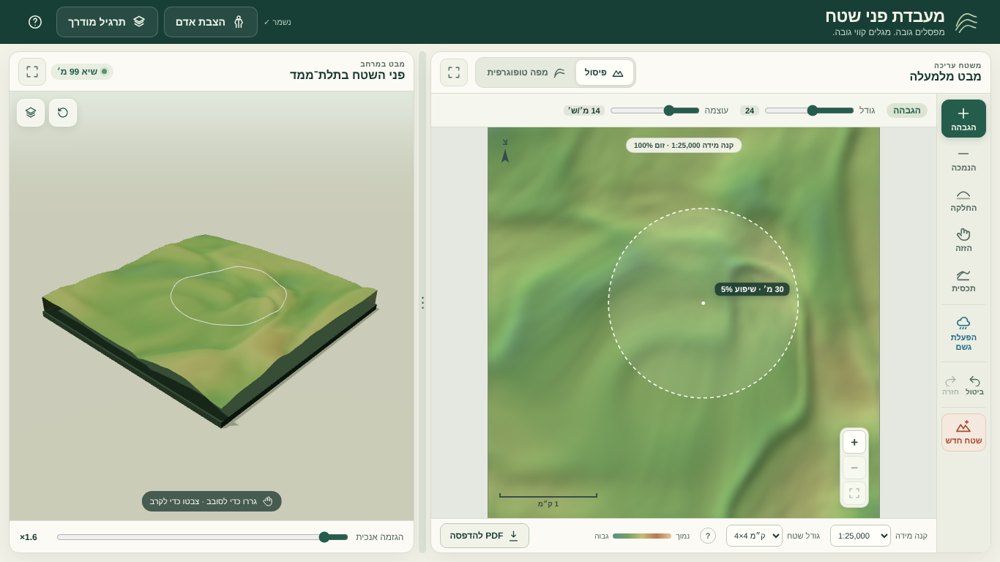

# מדריך ממשק

המסמך מתאר את הממשק כפי שנבנה בשלבים 1–2 של תוכנית השיפורים, ואת הכללים שכדאי לשמור עליהם כשמוסיפים דברים.



## עקרונות

1. **כלי אחד פעיל בכל רגע.** כל מה ש"נשאר דלוק" ומשנה את משמעות הלחיצה על המפה (הגבהה, הנמכה, החלקה, הזזה, תכסית) הוא *כלי* בסרגל הכלים. פעולות חד־פעמיות (תבנית, הגרלה, איפוס) נמצאות בתפריט **שטח חדש**.
2. **האפשרויות של הכלי צמודות אליו.** סרגל האפשרויות שמעל המפה מתחלף לפי הכלי הנבחר. לא מסתירים הגדרה שמשתמשים בה כל הזמן (גודל ועוצמה) בתוך חלון קופץ.
3. **בלי חלונות "האם אתם בטוחים?".** כל פעולה הורסת ניתנת לביטול. אחריה מופיעה הודעה עם כפתור "ביטול" (`showToast(msg, { action })`).
4. **העבודה לא הולכת לאיבוד.** שמירה אוטומטית בדפדפן ושחזור בטעינה.
5. **הכול נגיש גם מהמקלדת.** לכל כלי יש קיצור, והקיצור מופיע ב-tooltip ובחלון העזרה.
6. **המסך לא נגלל במחשב.** הממשק ממלא את גובה החלון (`.app-shell { height: 100dvh }`). בטלפון ובטאבלט לאורך הפאנלים נערמים והדף נגלל.

## מבנה המסך

```
┌───────────────────────── topbar ─────────────────────────────┐
│ מותג          [נשמר ✓] [הצבת אדם] [ניווט] [תרגיל מודרך] [?]     │
├──────────── map-panel ──────────────┬┬──── scene-panel ───────┤
│ כותרת      [פיסול | מפה טופוגרפית] ⛶ ││ כותרת      שיא · ⛶    │
├────┬─────────────────────────────────┤│                        │
│rail│ options-bar (לפי הכלי)           ││   תלת־ממד              │
│    ├─────────────────────────────────┤│   (טבעת מברשת)         │
│ +  │                                 ││                        │
│ −  │          map-wrap               ││                        │
│ ~  │    (מפה ריבועית, זום/הזזה)       ││                        │
│ ✋  │                                 ││                        │
│ ✎  ├─────────────────────────────────┤├────────────────────────┤
│ ☔ │ map-footer: קנה מידה · קווי גובה · ││ הגזמה אנכית             │
│↶ ↷ │ גודל שטח · ? · מקרא · PDF        ││                        │
│ ⛰  │                                 ││                        │
└────┴─────────────────────────────────┴┴────────────────────────┘
```

(בכיוון RTL המפה מימין והתלת־ממד משמאל. בין הפאנלים יש מפריד שאפשר לגרור, `splitter.js`.)

### סרגל הכלים (`.tool-rail`)

| כפתור | `id` | `data-tool` | קיצור | הערות |
|---|---|---|---|---|
| **עיצוב** | `sculptBtn` | הכלי האחרון מבין: `raise` `lower` `smooth` `smudge` `pinch` `flatten` | R L S M P E | כפתור אחד לכל כלי הפיסול. הבחירה ביניהם נעשית בסרגל האפשרויות (`#sculptModes`) או בתפריט הלחצן הימני. מתחת לכפתור מופיע הכלי הנוכחי (`#sculptSub`) |
| הזזה | `panMapBtn` | `pan` | H | אפשר גם בגרירה עם הכפתור האמצעי או ברווח, בכל רמת זום. הזום לא משתנה |
| תכסית | `featuresBtn` | `features` | F | **קווים**: שביל, שביל מסומן, דרך עפר, כביש, נחל איתן, נחל אכזב. **שטחים**: יער טבעי, יער נטוע, מטע, כרם, שדה, בנוי. ראו "שטחים" למטה |
| מסלול | `courseBtn` | `course` | C | ראו [NAVIGATION.md](NAVIGATION.md) |
| גשם | `rainBtn` | — | W | מתג, ראו [RAIN.md](RAIN.md) |
| טיפה | `dropBtn` | `drop` | D | עובד עם גשם ובלעדיו |
| נ״צ | `waypointBtn` | `waypoint` | K | לחיצה מסמנת נקודה עם הקואורדינטה שלה (צפון/מזרח, בדיוק של 100 מ׳). בזמן ריחוף מוצגים בסרגל האפשרויות הנ״צ והגובה. Backspace מסיר את הנקודה האחרונה |
| ביטול / חזרה | `undoBtn` / `redoBtn` | — | Ctrl+Z / Ctrl+Shift+Z | |
| שטח חדש | `newTerrainBtn` | — | N | |

**שטחים** (`src/areas.js`, עם בדיקות; ציור ותלת־ממד ב-`map-features.js`):
- **ציור:** לוחצים פינה אחר פינה, ולחיצה כפולה או Enter סוגרים את השטח. שטח שמצויר בתוך שטח אחר "חותך" אותו, למשל שדה בתוך יער יוצר קרחת יער.
- **במפה:** דוגמת מילוי בסגנון מפה מודפסת, שקופה מספיק כדי שקווי הגובה ייראו דרכה.
- **בתלת־ממד:** פני השטח נצבעים, ומופיעים עליו עצים עם גזע (יער טבעי לא סדיר, יער נטוע בשורות), שורות מטע וגפנים, ובתים עם גגות אדומים בשטח בנוי. בניווט כולם בגודל אמיתי.
- **השפעה על מהירות הניווט** (`speed` ב-`AREA_TYPES`):
  - יער טבעי ×0.55, יער נטוע ×0.7, מטע ×0.85, כרם ×0.8, שדה ×0.92, בנוי ×0.9.
  - **דרכים ושבילים מאיצים** (×1.1 עד ×1.25), וגוברים על השטח שהם עוברים בו.
  - ה-HUD מציג את סוג הקרקע ליד השיפוע.

**Ctrl + גלילה** על המפה משנה את קוטר המברשת, בלי זום.

**רשת הקואורדינטות**:
- כפתור **#** בשורה התחתונה של המפה קובע את ערכי מזרח וצפון בפינה הדרומית־מערבית. ברירת המחדל: 200000/600000.
- הערכים נשמרים, ומשפיעים על התוויות, על נקודות הציון ועל ה-PDF. הקוד ב-`src/grid-coords.js`, עם בדיקות.
- **מסגרת המפה** במצב טופוגרפי וב-PDF היא פס שחור־לבן לסירוגין לכל משבצת רשת (`drawMapFrame`), כמו בגיליון מודפס.

**תפריט לחצן ימני** (`#mapMenu`): לחיצה ימנית על המפה פותחת תפריט ליד הסמן עם כל הכלים: ששת כלי העיצוב, הזזה, תכסית, מסלול וטיפה. ליד כל כלי מופיע הקיצור שלו. מנווטים בחצים, ו־Esc סוגר.

**גשם, בפריסת מחשב**:
- **"מד" אנכי** בצד ימין של המפה (`.water-dock-top`, באותה שורה עם המפה, `.map-row`) מכיל כמות גשם, בולטות המים ואגני ניקוז. הוא לא מכסה את המפה.
- **הפירוט** (סיכום, אגנים, טיפה) נפתח בלחיצה על עיגול **i** בפינת המפה (`#waterInfoBtn`). העיגול מהבהב כשיש מידע חדש.
- **בטלפון** החלונית והפירוט מוצגים מעל המפה ומתחתיה.

### מבט במרחב (התצוגה התלת־ממדית)

- **מראה:**
  - **רקע:** שמיים.
  - **תאורה קרטוגרפית מצפון־מערב**, נמוכה מספיק כדי שהתבליט יבלוט, ועוד מילוי רך.
  - **הצללת תבליט** בצבעי הקודקודים (`reliefShade`): עמקים מעט כהים יותר, רכסים בהירים יותר, ומחשוף סלע במדרונות תלולים.
  - **צדי הדגם בשכבות סלע**, כמו בדגם בלוק גאולוגי. השכבות קבועות במטרים אמיתיים (`installStrataShader`).
  - **צל רך** מתחת לדגם, במקום רצפה אפורה.
- **מצפן** בפינה (`#viewCompassRose`): המחט מראה איפה הצפון על המסך. הכפתורים צ/מז/ד/מע מסובבים את המבט כך שהכיוון הזה למעלה, כמו כשמסובבים מפה.
- **כפתורים:**
  - מבט אלכסוני (איפוס).
  - מבט מלמעלה.
  - **שכבות** (`#viewLayersPanel`, נשמר ב-`topolab-view3d`):
    - קווי גובה על הדגם, גם במצב פיסול.
    - רשת הקואורדינטות פרוסה על השטח.
    - שכבות סלע.
    - צללים.
    - סיבוב אוטומטי.
- **מסגור:** הדגם ממלא את המסגרת לפי צורת הפאנל (`fitDistance`).

### סרגל האפשרויות (`#optionsBar`)

| קבוצה | מוצגת כאשר | תוכן |
|---|---|---|
| `#sculptOptions` | כל כלי העיצוב | בורר הכלי (6 כלים), **קוטר המברשת במטרים**, עוצמה, הסבר על כלי ההזזה, רמזי מקשים (רק במסכים רחבים מ־1440px) |
| `#panOptions` | הזזה | הסבר קצר |
| `#featureOptions` | תכסית | 6 סוגי קווים, צבע (רק לשביל מסומן), סיום/ביטול/הסרת האחרון, שורת סטטוס |
| `#courseOptions` | מסלול | בורר זינוק/נקודה/סיום, מספר נקודות ומסלול אקראי, הסרה/ניקוי, סיכום, ו"יציאה לניווט" |

### תפריט "שטח חדש" (`#newTerrainPopover`)

- תבניות: גבעה, רכס, עמק, מכתש.
- **ניקוי המפה**: מוחקים כל חלק בנפרד, תבליט, תכסית או מסלול (על כל כפתור מופיע מה קיים כרגע), או "ניקוי הכול". כל ניקוי הוא צעד ביטול אחד (`resetMap()`).
- **הגרלת מפה חדשה** (`#randomTerrainBtn`) בלחיצה אחת. ההגדרות המתקדמות (תבליט, שונות, חספוס, גאיות, מספר מפה) נמצאות ב-`<details>`.
- כל פעולה כאן נכנסת להיסטוריה ומציגה הודעה עם כפתור ביטול.
- בטלפון התפריט נפתח כחלונית מתחתית המסך.

### גודל השטח ורמת הפירוט

הבחירה נעשית בשורה התחתונה של המפה (`#mapSizeSelect`):

| גודל | נקודות ברשת | מרווח בין נקודות | הערות |
|---|---|---|---|
| 1×1 ק״מ | 201 או 101 | 5 מ׳ או 10 מ׳ | בורר `#detailSelect` ("דגימה כל") מופיע רק כאן. בהגרלה נוספים גאיות מקומיים ברוחב שאפשר לכוון (`#localGullyControl`) |
| 4×4 ק״מ | 96 | ‎~42 מ׳ | ברירת המחדל |
| 6×6 / 8×8 ק״מ | 144 / 192 | ‎~42 מ׳ | |

- מרווח הדגימה מוצג בתווית שבראש המפה ("קנה מידה · זום · דגימה כל X מ׳").
- **המברשת נמדדת במטרים (קוטר).** הגבולות שלה משתנים לפי המפה: מינימום של כ־4 נקודות דגימה לרוחב, ומקסימום בגודל צלע המפה. במעבר למפה של 1 ק״מ המברשת מתאפסת ל־100 מ׳, ובחזרה למפה גדולה חוזר הקוטר הקודם. `[`/`]` משנים את הקוטר בכ־10%.
- שינוי גודל או פירוט נכנס להיסטוריה וניתן לביטול.
- הבסיס של המודל התלת־ממדי מוקטן במפה של 1 ק״מ (`plinthScale()`), כדי שלא ייראה כמו לוח עבה.

### מתג התצוגה

`#sculptViewBtn` / `#topoBtn` הם `role="radio"` בתוך `.view-switch`. המצב נשמר ב-`state.topo`, והפונקציה `setTopo()` מעדכנת גם את בקרת מרווח הקווים שבתחתית המפה ואת המקרא.

### משוב בזמן עבודה

- **תווית ליד הסמן** (`#cursorReadout`): גובה ושיפוע באחוזים. במגע היא מוצגת גבוה יותר כדי שהאצבע לא תסתיר אותה.
- **טבעת מברשת בתלת־ממד**: `updateBrushRing()` ב-`scene.js`. הצבע משתנה לפי הכלי: לבן להגבהה, כתום להנמכה, תכלת להחלקה.
- **"נשמר ✓"** בסרגל העליון אחרי כל שמירה אוטומטית.

## קיצורי מקלדת

המקור היחיד הוא הטבלה `SHORTCUTS` ב-[`src/shortcuts.js`](../src/shortcuts.js). ממנה נבנים:
- ה-handler הגלובלי (`initShortcuts`),
- ה-tooltip של כל כפתור שיש לו `data-shortcut="<id>"`,
- הרשימה בחלון העזרה (`#shortcutList`).

המקשים מזוהים לפי `event.code` (המקש הפיזי), ולכן הם עובדים גם כשהמקלדת על עברית. הקיצורים לא פועלים כשמקלידים בשדה טקסט או כשחלון דו־שיח פתוח.

מקשים שמחזיקים (מטופלים ב-`scene.js` ולא בטבלה):

| מקש | פעולה | איפה |
|---|---|---|
| רווח | הזזת מפה זמנית, כשהעכבר מעל המפה | `setTempPan()` |
| Alt | היפוך הגבהה ↔ הנמכה בזמן ציור | `strokeToolFor(event)` |
| Shift | החלקה זמנית בזמן ציור | `strokeToolFor(event)` |
| Esc | בתכסית: ביטול הקו שבציור, ובלחיצה שנייה חזרה להגבהה. אחרת: סגירת תפריט, יציאה ממסך מלא או מתצפית | `keydown` ב-`scene.js` |

נגישות מקלדת על המפה עצמה (כשה-canvas בפוקוס): החצים מזיזים את סמן המברשת, ו־Enter או רווח מפעילים את הכלי.

## שמירה אוטומטית

- המודול: [`src/persistence.js`](../src/persistence.js). המפתח ב-localStorage: `topolab-autosave-v1`.
- **ביטול/חזרה משותפים לכל המפה**: ה-snapshot כולל גבהים, תכסית ומסלול (`currentSnapshot()`). ציור קו, הסרת קו, הצבה או גרירה של נקודת מסלול, מסלול אקראי וניקוי, כולם צעדים בהיסטוריה.
- **מה נשמר:** הגבהים (בדיוק של סנטימטר, Int16 ב-base64), גודל המפה, התכסית, וההגדרות `localSpacing, brushMeters, strength, topo, interval, scale, exaggeration`. שמירות ישנות שבהן `brush` היה באחוזים נטענות בלי ערך המברשת.
- **מתי:** 800ms אחרי שינוי, ובסגירת הדף (`pagehide`). הקריאות ל-`scheduleSave()` נמצאות בסוף משיכת מברשת, ב-`pushUndo()`, בשינוי הגדרות ובשינוי תכסית.
- **לא נשמר:** ההיסטוריה (ביטול/חזרה), מצב האדם והכבשה, הזום וההזזה.
- **בזמן תרגיל מודרך** השמירה מושבתת, כדי שהעבודה המקורית לא תידרס.
- אחרי שחזור מופיעה הודעה עם כפתור **"התחלה חדשה"**. גם הפעולה הזו ניתנת לביטול, חוץ מהתכסית (ראו ROADMAP).

## כשמוסיפים משהו לממשק

- כפתור שמשנה את משמעות הלחיצה על המפה צריך להיות **כלי** ולא מתג נפרד (ראו ARCHITECTURE → "הוספת כלי").
- פעולה הורסת: קודם `pushUndo()`, ואחר כך `showToast(msg, { action: { label: 'ביטול', run: undo } })`.
- הגדרה שהמשתמש מצפה שתישמר: מוסיפים אותה ל-`collectProject()` ול-`restoreProject()`.
- קיצור מקלדת: מוסיפים שורה ל-`SHORTCUTS`, handler ב-`initShortcuts({...})` ו-`data-shortcut` על הכפתור.
- טקסטים בעברית. תוויות קצרות בסרגל הכלים (עד כ-10 תווים, שתי שורות לכל היותר).
